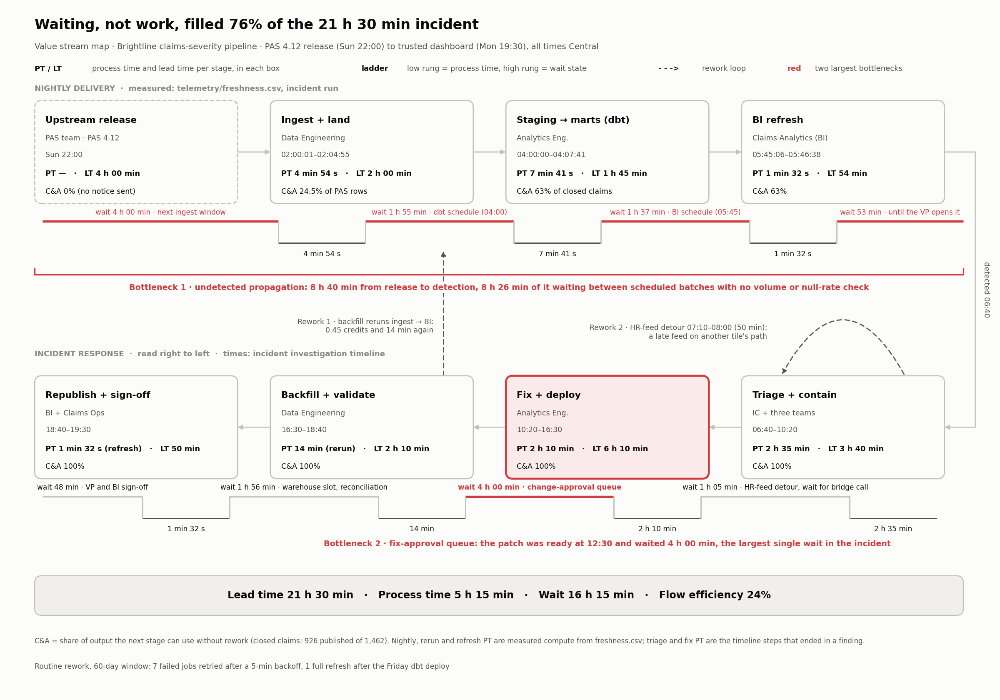

# Brightline Claims-Dashboard Incident

At 6:40 a.m. the VP of Claims Operations reports that the daily claims-severity
dashboard shows a 38% drop in closed claims, and staffing decisions are due in two
hours. This repo generates the observability evidence for that
incident as reproducible synthetic telemetry, then uses it to investigate.

## Quick start

```sh
python -m venv .venv
.venv\Scripts\activate        # Windows; use `source .venv/bin/activate` elsewhere
pip install -e ".[dev]"

make generate                 # writes telemetry/
make test                     # checks the telemetry against the answer key
```

Without `make`: `python -m generator --out telemetry` and `python -m pytest`.

Requires Python 3.11+. Dependencies are pinned exactly in `pyproject.toml`
because outputs must be byte-identical across runs.

## Telemetry

60 daily runs, Thu 2026-08-21 through the incident on Mon 2026-10-19. Times are
America/Chicago (CDT, `-05:00`).

| File | Grain | Contents |
|---|---|---|
| `freshness.csv` | job attempt | scheduled / queued / started / finished times, SLA deadline, status, error, run type (scheduled, retry, full_refresh), warehouse, credits used, rows scanned |
| `row_volume.csv` | table per run | rows written and resulting table size, load type, `run_id` linking to `freshness.csv` |
| `schema_changes.json` | change event | source and dbt schema changes: when each occurred and when ingest first loaded it, change ticket or PR, column and type changes, value mappings |
| `column_profiles.csv` | column per table per run | row count, null rate, distinct count, category mix (JSON), mean of `incurred_amount` |
| `lineage.json` | node / edge | source systems → ingest → staging → intermediate → marts → dashboards → tiles, with owners, schedules, columns read and SQL predicates per edge |
| `lineage.png` | | rendered lineage graph |

The pipeline: three sources (PAS policy admin, ClaimCenter, Workday HR) are
ingested at 02:00–03:00, dbt builds staging, `int_claims_enriched`, and three marts
from 04:00, and the dashboard extracts refresh at 05:45.

## How the data is generated

`src/generator/` simulates the entities first: about 167k policies, 64k claims
(from a January burn-in so open inventory is steady), and every write to a policy
record. `pipeline.py` then applies each model's logic to those rows run by run.
Row counts, null rates, and severity means are computed from those results, never
scaled or written in directly, so every anomaly in the telemetry follows from a
mechanism you can trace.

| Module | Role |
|---|---|
| `config.py` | window, incident events, pipeline DAG, simulation parameters |
| `world.py` | policies, claims, policy write events |
| `pipeline.py` | per-run row-level state and table row counts |
| `freshness.py`, `row_volume.py`, `schema_changes.py`, `column_profiles.py`, `lineage.py` | one output each |
| `rng.py` | named random streams from `default_rng(42)`; adding a component never reshuffles another's draws |

## Reproducibility

- One seed (42); each component draws from its own named child stream.
- CSVs use fixed float formats; JSON is key-sorted; every file uses `\n` line
  endings (enforced in git by `.gitattributes`); no generation timestamps.
- `lineage.png` uses fixed node positions, the bundled DejaVu Sans font, and no
  software metadata.
- `make test` regenerates everything and compares it byte for byte.

## Tests

`tests/test_answer_key.py` checks the properties the investigation depends on,
computed from the generated files: byte-identical re-runs, the closed-claims drop
size, raw-table volumes against prior Mondays, the timing of the `policy_status`
null-rate change relative to the schema log, and the presence of the red herrings.
The other test files check structural consistency across outputs.

## Deliverables

1. **[Incident investigation timeline](https://claude.ai/artifact/Vuy5u9GGzoUGQiEJcTStTc)**:
   symptoms vs six candidate causes, what each telemetry file ruled in or out,
   a minute-by-minute timeline, and the root cause with five lines of evidence.
   The answer: PAS release 4.12 renamed `policy_status` to `pol_status_cd`,
   leaving the old column NULL on policies written after the release, and the
   `policy_status = 'ACTIVE'` filter in `int_claims_enriched` silently dropped
   them. The tile showed 926 closed claims against a true 1,462 (−38.0% vs the
   prior-Monday median of 1,494) while every job ran green and on time.

   **Investigation demo.** `make demo` (or `python -m generator.demo`) loads
   `telemetry/` into an in-memory SQLite database and steps through the
   investigation, one query per Enter: the symptom, freshness, row volume by
   layer, severity and line-of-business mix, recent schema changes,
   `policy_status` column profiles, and finally lineage, which separates the PAS
   rename from the late HR feed and the Friday dbt deploy. Each finding is
   computed from the query result. Use `--no-pause` to run it straight through.

2. **[Value stream map](deliverables/value_stream_map.png)** (`make deliverables`):
   the nightly delivery path measured from `freshness.csv`, then the incident
   response from the timeline, with process and lead time per stage, wait
   states, rework loops, and the two largest bottlenecks: 8 h 40 min of
   undetected propagation between scheduled batches, and a 4 h fix-approval
   queue. Flow efficiency over the 21 h 30 min incident is 24%.

   

3. **[Cost driver table](deliverables/cost_driver_table.md)** (`make deliverables`):
   compute, rework and business-impact costs of this incident class, two
   prioritized countermeasures, and the stated assumptions. Quantities come from
   `telemetry/` and the timeline; every price and probability is an assumption
   listed below the table.

<!-- cost-table:start -->
| Category | Driver | Quantity | Unit cost | This incident | Expected per incident | Basis |
|---|---|---|---|---:|---:|---|
| Compute | Backfill rerun of the closed-claims path | 0.45 credits | $3.00/credit | $1.34 | $1.34 | freshness.csv, incident run (9 jobs) |
| Compute | Investigation queries (profiles, reconciliation, counterfactual) | 2.0 credits | $3.00/credit | $6.00 | $6.00 | assumption A6 |
| Rework | Triage and containment, incl. the HR-feed detour | 4 people × 3.67 h = 14.7 h | $95/h | $1,393 | $1,393 | timeline 06:40–10:20; detour 50 min |
| Rework | Fix and code review | 2.17 h + 0.5 h | $95/h | $253 | $253 | timeline 10:20–12:30 |
| Rework | Backfill and reconciliation (attended) | 2.17 h | $95/h | $206 | $206 | timeline 16:30–18:40 |
| Rework | Republish and sign-off | BI 0.83 h + VP 0.25 h | $95/h, $150/h | $117 | $117 | timeline 18:40–19:30 |
| Rework | Post-incident review | 5 people × 1.0 h | $95/h | $475 | $475 | assumption A9 |
| Business impact | Dashboard untrusted for decision users | 10 h (12 h 50 min untrusted) | $80/h | $800 | $800 | timeline 06:40–19:30; assumption A10 |
| Business impact | Staffing decision on a 38%-low closed-claims count | 11 of 212 adjusters × 40 h (536 claims missing ≈ 78 adjuster-weeks) | $60/h | $0.00 | $6,600 | exposure $26,400 × p = 25%; $0 realized (contained 06:55) |
| **Total** | | | | **$3,252** | **$9,852** | **$39,406/yr** at 4 incidents/yr |

Expected cost per incident by category: compute $7.34 (<1%), rework $2,444 (25%), business impact $7,400 (75%). Compute for the whole 60-day window was 27.9 credits ($83.67), so faster or cheaper compute would not change this incident class's cost.

**Countermeasures, in priority order**

| Priority | Countermeasure | Addresses | One-time cost | Annual run cost | Annual cost avoided | Net, year 1 | Payback |
|---|---|---|---:|---:|---:|---:|---:|
| 1 | Publish gate between `int_claims_enriched` and the marts: block on row-volume z-score, key-column null rate and schema drift; show "data delayed" on the dashboard | Bottleneck 1 (8 h 40 min undetected); every source, not just PAS; bad numbers never reach the tile, so the staffing exposure goes to $0; triage cut 50% | $3,800 | $2,369 | $29,187 | $23,017 | 1.7 months |
| 2 | Data contract on the PAS extract, tested in PAS CI, with data-consumer sign-off for breaking changes | Root cause (prevents the class at the source); 75% of incidents in the class never ship | $5,700 | $2,312 | $29,555 | $21,543 | 2.5 months |

Priority 1 comes first: it is cheaper, pays back sooner, covers ClaimCenter and Workday changes as well as PAS, and removes the largest driver (the staffing decision) even when a breaking change still ships. Priority 2 prevents 75% of incidents but needs PAS team time on every release (~24/yr observed). The two savings overlap (both act on the same incidents), so they are not additive.

**Assumptions**

- **A1.** Warehouse credits cost $3.00 each (list price).
- **A2.** Loaded rates: engineers and BI analysts $95/h, VP $150/h, Claims Ops users $80/h, adjusters $60/h.
- **A3.** Hours come from the incident investigation timeline; credits, adjuster headcount and claim counts come from telemetry/.
- **A4.** Triage involved 4 people for its full span (IC plus Data Eng, Analytics Eng and PAS on-call).
- **A5.** Fix review takes 0.5 h; VP sign-off takes 0.25 h.
- **A6.** Ad-hoc investigation queries used 2.0 credits.
- **A7.** A staffing decision made on the bad number would move 5% of adjusters for one week; the chance a bad number drives such a decision before detection is 25%.
- **A8.** The class recurs 4 times a year. Telemetry shows 1 silent breaking change among 8 source schema changes in 60 days (~6/yr); 4 assumes some changes fail loudly instead.
- **A9.** The post-incident review takes 5 people 1.0 h.
- **A10.** 20 decision users each lose 0.5 h to the untrusted dashboard.
- **A11.** Publish gate: 40 h to build, 2 h/month upkeep, nightly checks cost about the same as one `int_claims_enriched` run (0.082 credits); it cuts triage effort by 50%.
- **A12.** Data contract: 60 h to build, 1 h review per PAS release; it prevents 75% of incidents (renames and type changes on contracted columns).
<!-- cost-table:end -->

## Repository layout

```
src/generator/   telemetry generator (python -m generator)
telemetry/       generated outputs (committed)
tests/           pytest suite
CLAUDE.md        project spec and answer key for the generator
```
